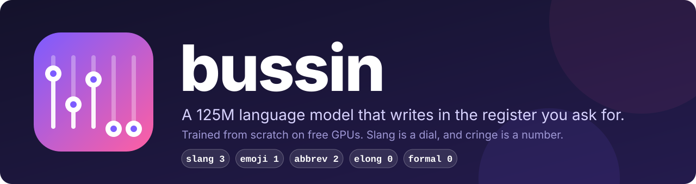
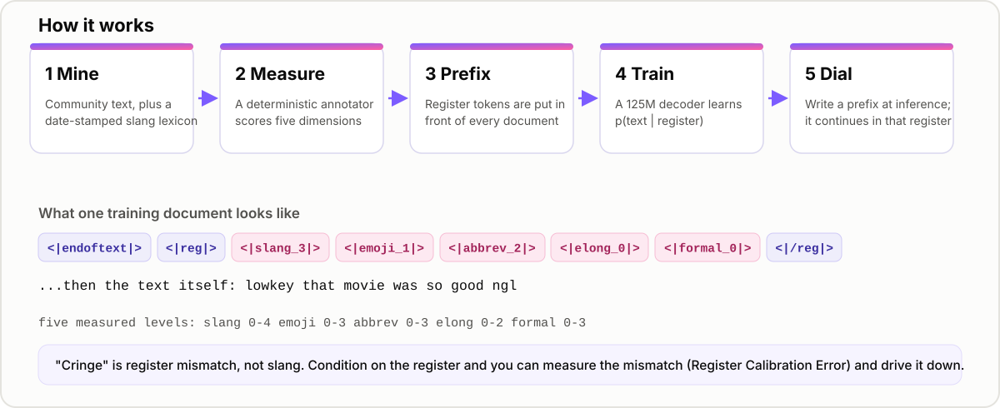
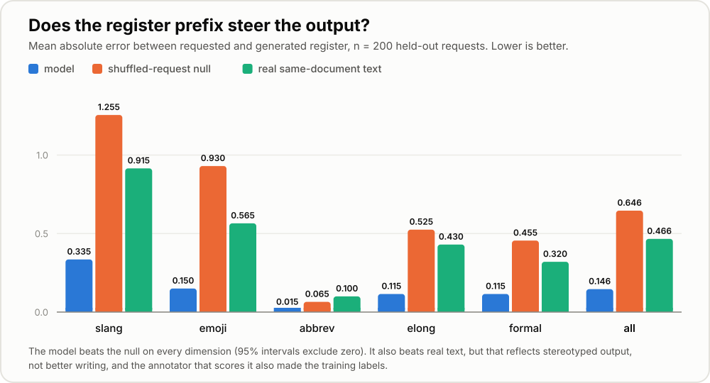
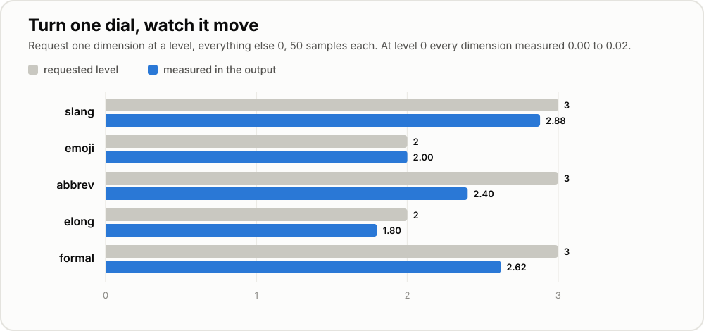
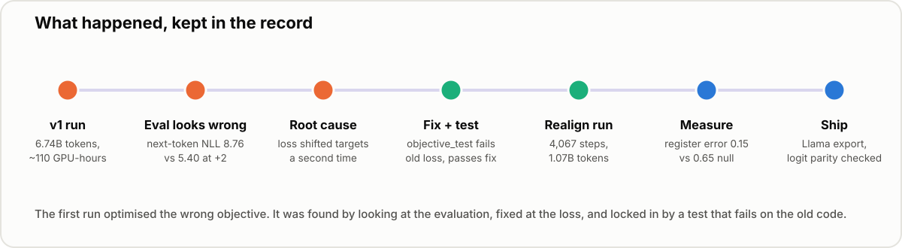
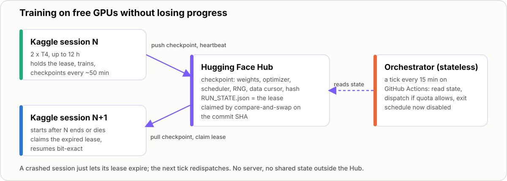

<p align="center">
  
</p>

<p align="center">
  <a href="https://huggingface.co/Ravikishan/bussin-125m"></a>
  
  
  
  
</p>

**Bussin** is a language model trained **from scratch** that writes in a register you choose: how slangy,
emoji-heavy, abbreviated, drawn-out and formal the text is. It is a research and portfolio project: small,
not instruction-tuned, and often incoherent. The parts worth reading are the method, the measurement, and the
infrastructure for training on free GPUs, including the mistakes.

| | |
|---|---|
| Model | [`Ravikishan/bussin-125m`](https://huggingface.co/Ravikishan/bussin-125m), a Llama-format checkpoint that loads with `transformers` |
| Architecture | 14 layers, d_model 768, 12 heads / 4 KV heads, SwiGLU, RoPE, tied embeddings, 49,152-token BPE, 1,024 context |
| Training | Run v1: 6.74B tokens (a loss bug, see below), then realign: 1.07B tokens with the corrected objective |
| Compute | About 110 GPU-hours on free Kaggle T4 x2 sessions, no paid compute |
| Headline result | Generated register error 0.146 vs 0.646 for a shuffled-request baseline, measured on 200 held-out requests |
| Write-up | [`docs/SPEC.md`](docs/SPEC.md) · [model card](docs/MODEL_CARD.md) · [results](docs/results/rce_final-4067.txt) |

## The idea

Nobody cringes at a teenager saying "that's so cooked" to a friend. They cringe when a bank's account says it.
So cringe is **register mismatch**, not slang. Bussin makes the register an explicit input: every training
document is prefixed with five measured register levels, and the model learns `p(text | register)`.

<p align="center"></p>

There is no Gen-Z pretraining corpus to download, so the register is mined from community text using a
date-stamped slang lexicon and a deterministic annotator. Once register is a conditioning variable, "cringe"
becomes a measurable number: **Register Calibration Error (RCE)**, the distance between the register you asked
for and the register you got.

## Does it work?

Yes, measurably, with caveats. 200 requests were taken from the measured registers of real held-out documents.
The model wrote 48 tokens from the prefix alone, and the annotator measured what came out.

<p align="center"></p>

Setting a single dial, with everything else at zero, moves exactly that dimension:

<p align="center"></p>

**Read these honestly.**

- The prefix steers the output: error is far below the shuffled baseline on every dimension, and all 95%
  intervals exclude zero.
- Beating the "real text" column does not mean writing better than people. The model produces stereotyped,
  easy-to-score registers, while real documents mix registers.
- The annotator that scores the output also produced the training labels. Its agreement with a human rater
  (one person) was Spearman 0.48, under the 0.70 gate I set.
- Only 21 of 200 requests were slang 3-4, and 193 of 200 had no abbreviations. One checkpoint, one seed set.

## Try it

```python
from transformers import AutoModelForCausalLM, AutoTokenizer

repo = "Ravikishan/bussin-125m"
tok = AutoTokenizer.from_pretrained(repo)
model = AutoModelForCausalLM.from_pretrained(repo).eval()

# levels: slang 0-4, emoji 0-3, abbrev 0-3, elong 0-2, formal 0-3
prompt = "<|endoftext|><|reg|><|slang_3|><|emoji_1|><|abbrev_2|><|elong_0|><|formal_0|><|/reg|>"
ids = tok(prompt, return_tensors="pt", add_special_tokens=False)
out = model.generate(**ids, max_new_tokens=60, do_sample=True, temperature=0.8,
                     top_k=50, top_p=0.95, pad_token_id=1)
print(tok.decode(out[0][ids["input_ids"].shape[1]:]))
```

## What went wrong

The first training run, 6.74B tokens and about 110 GPU-hours, **optimised the wrong objective**. The loss shifted
the targets a second time, so the model learned to predict the token two positions ahead. Nothing crashed. It
surfaced only because the evaluation looked wrong. The fix is one line; the lasting change is
`scripts/objective_test.py`, which fails on the old loss and passes on the fix.

<p align="center"></p>

The same audit found and fixed several accounting problems: tokens double-counted across two GPUs, one GPU
idle, the curriculum order shuffled, checkpoint pruning that could delete archived weights, and local checkpoints
filling the disk. Each has a test that fails on the old code (`scripts/accounting_test.py`,
`scripts/relay_e2e_test.py`). The full account is in `docs/SPEC.md` section 5.9e.

**Not measured or not done:** toxicity (samples contained crude and baseless accusatory text), downstream
benchmarks (BussBench has data for 3 of 15 tasks and known label problems), human validation of the annotator,
the 400M and 1B models (configs exist, never trained), and TPU training (unvalidated).

## Training on free GPUs

Free sessions end, so training is a relay. Each session checkpoints to the Hugging Face Hub and claims a lease
by compare-and-swap on the Hub's commit SHA. A crashed session just lets its lease expire, and a stateless
orchestrator starts the next one. Resume is bit-exact (`scripts/resume_test.py`, 0.0 relative divergence). The
orchestrator's schedule is disabled now that training is finished.

<p align="center"></p>

## Repository

```
docs/SPEC.md          specification and the audit of what held up
docs/MODEL_CARD.md    model card
docs/results/         measured results
docs/assets/          logo and figures (generated by scripts/make_figures.py)
configs/              training configs (125m-realign.yaml produced the released model)
bussin/model/         architecture (Llama-style)
bussin/data/          cleaning, dedup, lexicon, register annotation
bussin/train/         trainer, WSD schedule, precision
bussin/relay/         lease, checkpoint, watchdog, bootstrap
bussin/orchestrator/  platform adapters, ledger, dashboard
bussin/eval/          register metrics, BussBench (partial)
scripts/              tests, evaluation (rce_test.py, register_conditioning_test.py), HF export
pipelines/            lexicon, corpus mining, tokenizer, sharding
```

## Reproduce the checks

```bash
python scripts/model_sanity_test.py     # init loss, causality, document isolation, RoPE, GQA
python scripts/objective_test.py        # the model learns next-token, not skip-ahead
python scripts/accounting_test.py       # token accounting, curriculum order, prune scope
python scripts/lease_test.py            # lease compare-and-swap, two-worker race
python scripts/rce_test.py --ckpt <ckpt dir> --n 200      # register calibration (a GPU is much faster)
python scripts/export_hf.py --ckpt <ckpt dir> --out hf_export   # Llama export with a logit-parity check
```

## Data and licensing

Training text is **not** redistributed; only filter code and manifests are published. Source tiers are listed in
`docs/SPEC.md` section 1.12. Author columns are dropped at ingest and PII scrubbing runs over message bodies.
Much of the slang lexicon has African American English provenance, and the model card says so.

Code is MIT. The weights are for research and non-commercial use only, pending legal review of mixed source
licences.
