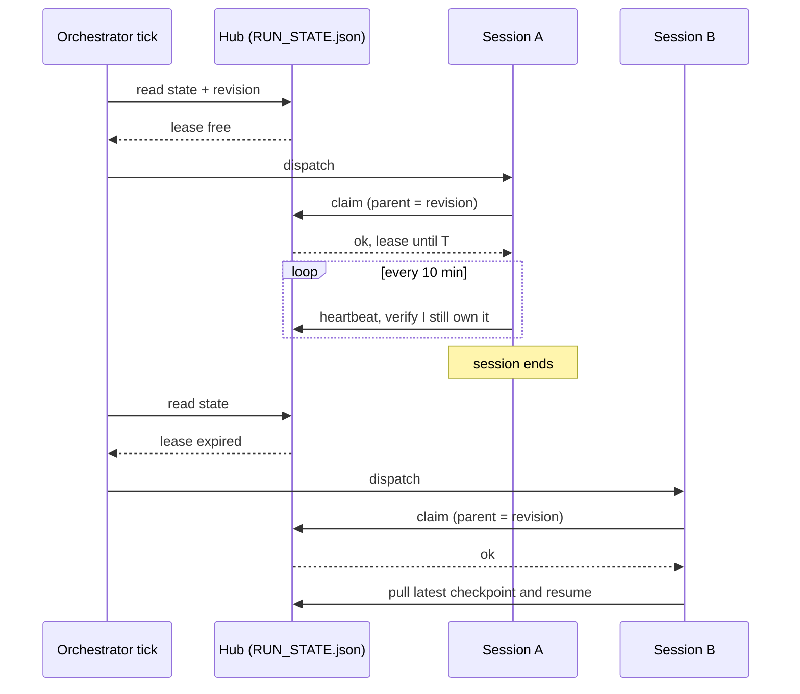

> **TL;DR**: I built a language model **from scratch, end to end, on free GPUs**: a 125.9M-parameter model that writes in a register you choose, with slang, emoji, abbreviation, elongation and formality as five dials. The idea is simple and testable: measure the register of every training document with code, write it as five control tokens in front of the text, and the model learns `p(text | register)`. On 200 held-out requests the generated register lands within **0.146** of the request on average, against **0.646** for a shuffled-request baseline. Behind that number sit a dated slang lexicon, a deterministic register annotator, a data pipeline and tokenizer, a verified Llama-style model, a lease-based training relay that turns flaky free sessions into one continuous run, a regression-tested training stack, and a Llama-format export that loads in three lines of `transformers`. Five live sketches below let you poke each idea.
>
> Model: [`Ravikishan/bussin-125m`](https://huggingface.co/Ravikishan/bussin-125m) · Code: [`Ravikisha/Bussin`](https://github.com/Ravikisha/Bussin)

## The numbers at a glance

| | |
|---|---|
| Model | 125.9M parameters, Llama architecture, 49,152-token vocabulary, 1,024 context |
| Training | About 7.8 billion tokens on free Kaggle T4 pairs, $0 spent |
| Register control | Register error 0.146 against 0.646 for a shuffled-request baseline (200 held-out requests) |
| One dial at a time | `slang_3` measured 2.88, `emoji_2` measured 2.00, `abbrev_3` measured 2.40 |
| Verification | Six behavioural test suites; export matches the original to 3.6e-05 in logits |
| Try it | [`Ravikishan/bussin-125m`](https://huggingface.co/Ravikishan/bussin-125m) on the Hub, code on [GitHub](https://github.com/Ravikisha/Bussin) |

---

## Table of Contents

1. [The idea: cringe is register mismatch](#the-idea-cringe-is-register-mismatch)
2. [What I built](#what-i-built)
3. [Register as an input](#register-as-an-input)
4. [Measuring register with code](#measuring-register-with-code)
5. [A dated lexicon that knows what is current](#a-dated-lexicon-that-knows-what-is-current)
6. [The data pipeline and tokenizer](#the-data-pipeline-and-tokenizer)
7. [The model](#the-model)
8. [Training systems](#training-systems)
9. [The relay: continuous training on free compute](#the-relay-continuous-training-on-free-compute)
10. [Engineering rigor](#engineering-rigor)
11. [Results](#results)
12. [Talking to it](#talking-to-it)
13. [Shipping it](#shipping-it)
14. [Skills this project demonstrates](#skills-this-project-demonstrates)
15. [What is next](#what-is-next)

---

## The idea: cringe is register mismatch

Ask a general-purpose model to "talk like Gen Z" and you get *"Dear Sir, no cap, I hope this email finds you bussin."* It knows the words. It has no model of **when** they fit.

That led to the central observation of this project: nobody cringes at a teenager saying "that's so cooked" to a friend. They cringe when a bank's Twitter account says it. So cringe is not *slang*. It is **register mismatch**: the words do not fit the setting.

If that is right, the average-of-all-text model is the wrong tool, because averaging the register of a contract and a Twitch chat produces exactly that blend. What you want is a model that treats register as something you can **set**, and a way to **measure** whether it did what you asked. Both turned out to be buildable with no human labelling at all.

## What I built

This is a full-stack project, and every layer is code in one repository, with tests:

| layer | what I built |
|---|---|
| Research | A 17-section specification: the thesis, the data tiers, the compute plan, the evaluation design |
| Lexicon | A dated slang dictionary with `current` / `aging` / `dead` status and emerging-term discovery |
| Annotator | A deterministic five-dimension register scorer that also grades model output |
| Data | Mining, cleaning, language routing, PII scrubbing, stage-ordered uint16 shards |
| Tokenizer | A 49,152-token byte-level BPE with the register control tokens built in |
| Model | A Llama-style 125.9M decoder with a verification suite |
| Training | WSD schedule, curriculum, multi-GPU trainer, exact token accounting, hashed checkpoints |
| Systems | A lease-based relay and a stateless orchestrator that run training across free sessions |
| Evaluation | Register Calibration Error, a paired likelihood test, single-dimension sweeps |
| Release | A Llama-format export with a logit-parity check, a model card, a repo with figures |


## Register as an input

Instead of `p(text)`, learn `p(text | register)`:

$$\mathcal{L}(\theta) = -\sum_{t} \log p_\theta\left(x_t \mid x_{\lt t},\, r\right)$$

where $r$ is a short vector describing the register of the whole document. In practice $r$ is five small integers, written as control tokens in front of every training document:

```
<|endoftext|><|reg|><|slang_3|><|emoji_1|><|abbrev_2|><|elong_0|><|formal_0|><|/reg|> ngl that movie was bussin
```

At inference you write the prefix yourself and the model continues in that register. Slang stops being a prompt trick and becomes a **dial**.


| dimension | levels | what it measures |
|---|---|---|
| `slang` | 0 to 4 | weighted lexicon hits per 100 tokens |
| `emoji` | 0 to 3 | emoji and chat emotes per 100 tokens |
| `abbrev` | 0 to 3 | internet abbreviations (`ngl`, `tbh`, `fr`) per 100 tokens |
| `elong` | 0 to 2 | stretched words (`sooooo`) and keysmashes |
| `formal` | 0 to 3 | a 0 to 1 formality score from five signals |

The register tokens are real vocabulary: 34 special tokens with fixed ids, including end-of-text, padding, register open and close, and every dimension level, so slang level 3 is always token 7. Drag the knobs to build a prefix and see exactly what the model is given, with the real token ids. Set a single dial to its sweep level to see what the trained model produced for it.

```p5 height=330
const DIMS = [
  { n: 'slang', max: 4, base: 4, sweep: 3, got: 2.88 },
  { n: 'emoji', max: 3, base: 9, sweep: 2, got: 2.00 },
  { n: 'abbrev', max: 3, base: 13, sweep: 3, got: 2.40 },
  { n: 'elong', max: 2, base: 17, sweep: 2, got: 1.80 },
  { n: 'formal', max: 3, base: 20, sweep: 3, got: 2.62 }
];
let lv = [3, 1, 2, 0, 0], drag = -1;
const L = 130;
function setup() { createCanvas(windowWidth, 330); textFont('monospace'); }
function windowResized() { resizeCanvas(windowWidth, 330); }
function R() { return width - 200; }
function rowY(i) { return 46 + i * 42; }
function draw() {
  background(22, 24, 29);
  noStroke(); fill(235); textAlign(LEFT, TOP); textSize(constrain(width / 55, 12, 15));
  text('drag the knobs: this is exactly the prefix the model sees', 16, 10);
  for (let i = 0; i < 5; i++) {
    const d = DIMS[i], y = rowY(i) + 12;
    fill(200); textAlign(LEFT, CENTER); textSize(13); text(d.n, 16, y);
    fill(46, 52, 64); rect(L, y - 4, R() - L, 8, 4);
    fill(124, 92, 255); rect(L, y - 4, (R() - L) * lv[i] / d.max, 8, 4);
    for (let k = 0; k <= d.max; k++) { fill(110); circle(L + (R() - L) * k / d.max, y, 5); }
    const kx = L + (R() - L) * lv[i] / d.max;
    fill(255); circle(kx, y, 22); fill(124, 92, 255); circle(kx, y, 9);
    fill(235); textAlign(LEFT, CENTER); text('level ' + lv[i] + ' (id ' + (d.base + lv[i]) + ')', R() + 22, y);
  }
  const ids = [0, 2].concat(DIMS.map((d, i) => d.base + lv[i]), [3]);
  const str = '<|reg|>' + DIMS.map((d, i) => '<|' + d.n + '_' + lv[i] + '|>').join('') + '<|/reg|>';
  fill(255, 217, 234); textAlign(LEFT, TOP); textSize(constrain(width / 62, 10, 14)); text(str, 16, 262);
  fill(150); textSize(12); text('token ids: [' + ids.join(', ') + ']   (0 = end of text, 2 and 3 = register open and close)', 16, 284);
  const nz = lv.map((v, i) => v > 0 ? i : -1).filter(i => i >= 0);
  let note = 'set one dial to its sweep level (slang 3, emoji 2, abbrev 3, elong 2, formal 3), others at 0, to see the measured result';
  if (nz.length === 0) note = 'all dials at 0: every dimension measured 0.00 to 0.02 in the output (50 samples)';
  if (nz.length === 1 && lv[nz[0]] === DIMS[nz[0]].sweep) note = 'measured ' + DIMS[nz[0]].n + ' in the output: ' + DIMS[nz[0]].got.toFixed(2) + '  (requested ' + lv[nz[0]] + ', 50 samples)';
  fill(42, 190, 160); textSize(constrain(width / 60, 11, 14)); text(note, 16, 306);
}
function mousePressed() {
  drag = -1;
  for (let i = 0; i < 5; i++) if (abs(mouseY - (rowY(i) + 12)) < 20) drag = i;
  mouseDragged();
}
function mouseDragged() {
  if (drag < 0) return;
  const d = DIMS[drag];
  lv[drag] = constrain(round(map(mouseX, L, R(), 0, d.max)), 0, d.max);
}
function mouseReleased() { drag = -1; }
```

The whole pipeline, end to end:

```mermaid
flowchart LR
    A[Community and web text] --> B[Clean: bots, language, PII]
    B --> C[Dedup]
    C --> D[Register annotator + dated lexicon]
    D --> E[Prefix with 5 control tokens]
    E --> F[Tokenize into stage-ordered shards]
    F --> G[Train on free GPUs with a relay]
    G --> H[Checkpoint on the Hugging Face Hub]
    H --> I[Evaluate with the same annotator]
```




The last arrow is the part I like most. Because the register is **measured** by code and not labelled by people, the same annotator that labels the training corpus can score what the model writes. That makes "cringe" a number, which I call **Register Calibration Error** (RCE):

$$\mathrm{RCE} = \frac{1}{N}\sum_{n=1}^{N} \frac{1}{5}\sum_{d \in \text{dims}} \left| r^{\text{requested}}_{n,d} - r^{\text{generated}}_{n,d} \right|$$

It rises when the model under-uses slang and when it over-uses it, so it cannot be gamed by suppressing slang.

## Measuring register with code

The annotator is deterministic code in `bussin/data/register.py`: no LLM calls, no human labelling, and cheap enough to run over a whole corpus (it is budgeted at about 30,000 documents per second per core). The thresholds that turn raw rates into levels:

| dimension | cut points | unit |
|---|---|---|
| slang | 0.5, 2, 5, 10 | weighted hits / 100 tokens |
| emoji | 0.5, 2, 6 | emoji / 100 tokens |
| abbrev | 2, 6, 14 | abbreviations / 100 tokens |
| elong | 1, 4 | elongation events / 100 tokens |
| formal | 0.30, 0.55, 0.78 | score from 0 to 1 |

The design decisions are where the thinking is:

- **Calibrated buckets.** The cut points are chosen so every level holds a meaningful slice of the corpus. A short chat message is about 10 tokens, so a rate per 100 tokens would put a single slang word in the top bucket. Dividing by at least 30 tokens treats a short message as weak evidence, which gives the model a smooth gradient of levels to learn from instead of two extremes.
- **Ambiguity handling.** "Living" and "cap" are ordinary words *and* slang. Ambiguous words count at 30% weight unless the document also contains an unambiguous slang term, which anchors them at full weight. That trades a little recall for far fewer false positives on ordinary prose.
- **One signal, one dimension.** Emotes (`KEKW`) and abbreviations (`ngl`) feed their own dimensions and are excluded from the slang count, even though dictionaries list them too.
- **Formality from five signals.** Terminal punctuation, capitalised sentence starts, mean word length, formal function words (`however`, `therefore`) and the absence of chat markers, averaged with equal weight.

Here is a simplified port you can poke. It uses a small lexicon, but the thresholds, the 30-token floor, the anchoring rule and the five-signal formality score are the real ones. Click to change the message, and toggle the floor to see what it does to the one-word example.

```p5 height=400
const EX = [
  "Please find the attached report; however, the figures require further review.",
  "ngl that movie was bussin fr no cap 💀",
  "bro is cooked lmaooo sooooo bad 😭😭",
  "Per our earlier discussion, the committee therefore approved the budget.",
  "omg that ate. no crumbs. periodt 🔥🔥",
  "bussin"
];
const SLANG = { bussin: 1, cooked: 1, crumbs: 1, periodt: 1, slay: 1, mid: 1, bro: 1 };
const AMBIG = { cap: 1, ate: 1, fire: 1 };
const ABBR = new Set(["ngl", "tbh", "fr", "omg", "idk", "lol", "lmao", "rn", "btw", "imo", "smh"]);
const FORMAL = new Set(["however", "therefore", "moreover", "furthermore", "regarding", "approximately", "significant", "particular"]);
const TH = { slang: [0.5, 2, 5, 10], emoji: [0.5, 2, 6], abbrev: [2, 6, 14], elong: [1, 4], formal: [0.30, 0.55, 0.78] };
const SC = { slang: 12, emoji: 8, abbrev: 16, elong: 6, formal: 1 };
const DIMS = ["slang", "emoji", "abbrev", "elong", "formal"];
let idx = 0, smooth = true, lastAct = 0;

function setup() { createCanvas(windowWidth, 400); textFont('monospace'); lastAct = millis(); }
function windowResized() { resizeCanvas(windowWidth, 400); }

function bucket(v, edges) { let b = 0; for (const e of edges) { if (v >= e) b++; else break; } return b; }

function analyze(t) {
  const toks = t.match(/[\p{L}\p{N}']+|[^\s\p{L}\p{N}]/gu) || [];
  const words = t.match(/[\p{L}\p{N}']+/gu) || [];
  const n = Math.max(toks.length, smooth ? 30 : 1), per = 100 / n;
  const low = words.map(w => w.toLowerCase());
  const hits = low.filter(w => SLANG[w] || AMBIG[w]);
  const anchored = hits.some(w => SLANG[w]);
  const slangSum = hits.reduce((s, w) => s + (SLANG[w] || anchored ? 1 : 0.3), 0);
  const emoji = (t.match(/\p{Extended_Pictographic}/gu) || []).length;
  const abbr = low.filter(w => ABBR.has(w)).length;
  const rep = (t.match(/(.)\1{2,}/gu) || []).length;
  const nW = Math.max(words.length, 1);
  const terminal = /[.!?]/.test(t) ? 1 : 0;
  const caps = words.filter(w => /^\p{Lu}/u.test(w)).length;
  const capR = Math.min(caps / Math.max(nW / 12, 1), 1);
  const lenS = constrain((words.reduce((s, w) => s + w.length, 0) / nW - 3) / 3, 0, 1);
  const fS = Math.min(low.filter(w => FORMAL.has(w)).length / Math.max(nW / 60, 1), 1);
  const chat = Math.min(low.filter(w => ABBR.has(w)).length / Math.max(nW / 15, 1), 1);
  const formality = (terminal + capR + lenS + fS + (1 - chat)) / 5;
  const raw = { slang: 100 * slangSum / n, emoji: emoji * per, abbrev: abbr * per, elong: rep * per, formal: formality };
  const lv = {}; for (const d of DIMS) lv[d] = bucket(raw[d], TH[d]);
  return { raw, lv, n };
}

function chunkColor(c) {
  const w = c.toLowerCase().replace(/[^\p{L}\p{N}']/gu, '');
  if (/\p{Extended_Pictographic}/u.test(c)) return color(255, 209, 102);
  if (SLANG[w] || AMBIG[w]) return color(239, 71, 111);
  if (ABBR.has(w)) return color(244, 140, 6);
  if (FORMAL.has(w)) return color(86, 160, 255);
  if (/(.)\1{2,}/u.test(c)) return color(42, 190, 160);
  return color(225);
}

function draw() {
  background(22, 24, 29);
  if (millis() - lastAct > 6000) { idx = (idx + 1) % EX.length; lastAct = millis() - 3000; }
  const t = EX[idx], a = analyze(t);
  // message with colour-coded tokens
  textSize(constrain(width / 40, 13, 19)); textAlign(LEFT, TOP);
  let x = 16, y = 18; const lh = textSize() * 1.5;
  for (const c of t.split(/(\s+)/)) {
    if (!c) continue;
    const w = textWidth(c);
    if (x + w > width - 16 && !/^\s+$/.test(c)) { x = 16; y += lh; }
    fill(chunkColor(c)); noStroke(); text(c, x, y); x += w;
  }
  // smoothing toggle
  const bx = width - 190, by = height - 44;
  fill(smooth ? color(42, 157, 143) : color(90)); rect(bx, by, 174, 28, 8);
  fill(255); textSize(12); textAlign(CENTER, CENTER);
  text('30-token floor: ' + (smooth ? 'ON' : 'OFF'), bx + 87, by + 14);
  // bars
  const top = 136, rowH = 40, x0 = 100, x1 = width - 170;
  for (let i = 0; i < 5; i++) {
    const d = DIMS[i], yy = top + i * rowH;
    fill(200); textAlign(LEFT, CENTER); textSize(13); text(d, 16, yy + 10);
    fill(40, 44, 54); rect(x0, yy, x1 - x0, 20, 6);
    const frac = constrain(a.raw[d] / SC[d], 0, 1);
    fill(124, 92, 255); rect(x0, yy, (x1 - x0) * frac, 20, 6);
    stroke(255, 120); strokeWeight(1.5);
    for (const e of TH[d]) { const ex = x0 + (x1 - x0) * constrain(e / SC[d], 0, 1); line(ex, yy - 2, ex, yy + 22); }
    noStroke(); fill(235); textAlign(LEFT, CENTER);
    text(a.raw[d].toFixed(d === 'formal' ? 2 : 1) + ' -> ' + a.lv[d], x1 + 10, yy + 10);
  }
  fill(255, 160); textAlign(LEFT, CENTER); textSize(12);
  text('n = ' + a.n + ' tokens used for the rate' + (a.n === 30 ? '  (floor active)' : ''), 16, height - 30);
  fill(255, 217, 234); textSize(constrain(width / 62, 10, 14));
  text('<|reg|>' + DIMS.map(d => '<|' + d + '_' + a.lv[d] + '|>').join('') + '<|/reg|>', 16, height - 10);
}

function mousePressed() {
  lastAct = millis();
  if (mouseX > width - 190 && mouseX < width - 16 && mouseY > height - 44 && mouseY < height - 16) smooth = !smooth;
  else idx = (idx + 1) % EX.length;
}
```

## A dated lexicon that knows what is current

Slang needs a lexicon, and a lexicon needs a source. I built mine from the largest public Urban Dictionary dump plus curated lists. Every term carries a first-seen date and a status (`current`, `aging` or `dead`) that is refined from corpus evidence, and the dead terms double as a test set for outdated slang.

Then I stress-tested it against 19 contemporary terms and learned something useful about the structure of the problem: the newest definition in that dump is dated **2023-11-09**, so a dated dictionary can say what is *dead* but structurally cannot say what is *current*. Lexicographers lag usage by years and the dumps lag the lexicographers. So the lexicon has three layers:

- **Dated sources** for the long tail and for status.
- **`CURRENT_SLANG`**: a curated set of unambiguous recent coinages (`bussin`, `skibidi`, `fanum tax`, `mewing`, `cheugy`) that doubles as the *anchor* set for the ambiguity rule above.
- **`DRIFTED_SENSES`**: ordinary words whose meaning moved, with a documented sense for each: `cooked` ("ruined, or doing extremely well"), `ate` ("performed excellently"), `cap`, `bet`, `mid`, `no crumbs`, `hits different`. A frequency filter normally removes these, and it is right to in general, so each exemption needs a written reason.
- **Emerging-term discovery**: a corpus pass that ranks words by recent-versus-baseline frequency against an English vocabulary, so new slang can enter the lexicon from the data itself.

The build turns 152,941 dictionary definitions into 55,499 terms plus 1,322 curated entries.

## The data pipeline and tokenizer

The pipeline is a sequence of numbered stages, from building the lexicon through mining, tokenizer training, tokenization and sharding. A few choices worth calling out:

- **Language routing, not language dropping.** Statistical language ID is unreliable on short chat, so the router combines `py3langid` with marker lists and routes English and Hinglish into their own pools, dropping other languages.
- **PII scrubbing on the body.** A mandatory pass over the text itself, not just the schema, replaces handles, emails, phone numbers and similar patterns with placeholder tokens.
- **Author columns dropped at ingest**, before anything is written.
- **Elongation capped but remembered.** `sooo` and `soooooo` carry different register information, so the cleaner caps the run length and records the original length for the annotator.
- **Stage-ordered shards.** Tokens are written as uint16 shards tagged with a curriculum stage, so training order is a property of the data, not of a flag.
- **A tokenizer gate.** The 49,152-token byte-level BPE had to pass a round-trip check before any training: exact round trip (1.0000) and 3.37 bytes per token on Gen-Z text.

## The model

A small Llama-style decoder. The point of choosing something standard is that every result is about the data and the objective, not the network.

| | |
|---|---|
| Parameters | 125,851,392 |
| Layers / width | 14 / 768 |
| Attention | 12 query heads, 4 KV heads (grouped-query), head dim 64 |
| FFN | SwiGLU, hidden 2048 |
| Positions | RoPE, theta 10,000 |
| Norm | RMSNorm (computed in fp32) |
| Embeddings | tied; vocabulary 49,152 (byte-level BPE) |
| Context | 1,024 |

Embeddings are $49152 \times 768 = 37{,}748{,}736$ parameters, about 30% of the model, which is why tying them pays off at this size. Three implementation details:

- **Block-diagonal document mask.** Training packs several short documents into one window. The mask is causal *and* limited to the same document, so nothing attends across a boundary.
- **fp16 plus a gradient scaler.** The free T4 GPUs have no bf16, so activations run in fp16 while logits and loss are computed in fp32, where a 49k-wide logit row does not saturate.
- **z-loss.** A small penalty keeps the log-partition from drifting:

$$\mathcal{L} = \mathrm{CE} + 10^{-4}\,\overline{\left(\log \sum_j e^{z_j}\right)^{2}}$$

The model ships with its own verification suite: parameter counts match the analytic formula exactly at all four planned sizes (125M, 400M, 1B and a smoke model); untrained cross-entropy lands at 10.95 against $\ln(49152) \approx 10.80$; and tests assert causality, document isolation, RoPE against an independent reference implementation, and grouped-query head grouping.

The same code scales: the repository carries configurations for 400M (396,418,176 parameters) and 1B (1,255,245,824), sized so that the 400M model reaches 75.7 tokens per parameter on the same free-compute plan.

## Training systems

**A schedule built for an unknown budget.** The usual cosine schedule needs the total step count before step one. A free quota is genuinely unknown (Kaggle's own wording is "30 hours or sometimes higher depending on demand"), so I used **Warmup-Stable-Decay**: warm up, hold the peak for as long as the quota lasts, then decay whenever you decide to finish.

$$
\eta(s) =
\begin{cases}
\eta_{\max}\,\dfrac{s+1}{W} & s \lt W \\[4pt]
\eta_{\max} & W \le s \lt S \\[4pt]
\eta_{\min} + (\eta_{\max}-\eta_{\min})\left(1-\sqrt{\dfrac{s-S}{D}}\right) & s \ge S
\end{cases}
$$

The decay phase doubles as the **Gen-Z anneal**: the last steps run at a low learning rate over the most contemporary data, so register gets shaped without overwriting the general-English competence learned earlier. A stable-phase checkpoint stays valid, so a different ending never costs the whole run. Move your mouse across the plot to change when the quota ends:

```p5 height=330
const TOT = 4067, WU = 150, LMAX = 3e-4, LMIN = 3e-5, SPAN = 936, TOKPS = 262144;
let stopStep = 3131, usedMouse = false;
function setup() { createCanvas(windowWidth, 330); textFont('monospace'); }
function windowResized() { resizeCanvas(windowWidth, 330); }
function wsd(s, stop) {
  if (s < WU) return LMAX * (s + 1) / WU;
  if (s < stop) return LMAX;
  const t = min((s - stop) / SPAN, 1);
  return LMIN + (LMAX - LMIN) * (1 - sqrt(t));
}
function cosSched(s) {
  if (s < WU) return LMAX * (s + 1) / WU;
  const t = min((s - WU) / (TOT - WU), 1);
  return LMIN + (LMAX - LMIN) * 0.5 * (1 + cos(PI * t));
}
function draw() {
  background(22, 24, 29);
  const L = 70, R = width - 24, T = 40, B = height - 92, XMAX = 5200;
  const px = s => L + (R - L) * s / XMAX, py = v => B - (B - T) * v / 3.4e-4;
  if (!usedMouse) stopStep = 2300 + 1000 * sin(millis() / 2600);
  else if (mouseX > L && mouseX < R && mouseY > 0 && mouseY < height) stopStep = constrain(map(mouseX, L, R, 0, XMAX), 400, 4200);
  // data stages under the plot
  noStroke(); fill(52, 58, 70); rect(px(0), B + 34, px(stopStep) - px(0), 18, 4);
  fill(124, 92, 255); rect(px(stopStep), B + 34, px(stopStep + SPAN) - px(stopStep), 18, 4);
  fill(220); textSize(11); textAlign(LEFT, CENTER);
  text('general + ramp data', px(0) + 8, B + 43); fill(255); text('Gen-Z anneal', px(stopStep) + 8, B + 43);
  // axes
  stroke(60); line(L, B, R, B); line(L, T, L, B);
  noStroke(); fill(130); textSize(11); textAlign(RIGHT, CENTER);
  for (const v of [0, 1e-4, 2e-4, 3e-4]) text(v.toExponential(0), L - 8, py(v));
  textAlign(CENTER, TOP); for (const s of [0, 1000, 2000, 3000, 4000, 5000]) text(s, px(s), B + 8);
  // cosine curve (total fixed at 4067 steps)
  noFill(); stroke(235, 104, 52); strokeWeight(2);
  drawingContext.setLineDash([6, 5]); beginShape();
  for (let s = 0; s <= TOT; s += 10) vertex(px(s), py(cosSched(s))); endShape();
  drawingContext.setLineDash([]);
  // WSD curve
  stroke(124, 92, 255); strokeWeight(3); beginShape();
  for (let s = 0; s <= stopStep + SPAN; s += 10) vertex(px(s), py(wsd(s, stopStep))); endShape();
  // stop marker
  stroke(255, 120); strokeWeight(1); line(px(stopStep), T, px(stopStep), B);
  const cs = cosSched(stopStep);
  noStroke(); fill(235, 104, 52); circle(px(stopStep), py(cs), 11);
  textAlign(LEFT, TOP); textSize(constrain(width / 55, 11, 14));
  fill(235); text('quota ends at step ' + round(stopStep) + '  (' + (stopStep * TOKPS / 1e9).toFixed(2) + 'B tokens)', L, 8);
  fill(235, 104, 52); text('cosine stopped here: lr still ' + cs.toExponential(1), L, B + 62);
  fill(160, 140, 255); text('WSD: hold, then anneal to ' + LMIN.toExponential(0) + ' over the Gen-Z data', L + (R - L) * 0.5, B + 62, (R - L) * 0.5);
  fill(120); textSize(11); text('move your mouse across the plot', R - 190, 8);
}
function mouseMoved() { usedMouse = true; }
```

**Curriculum as data order.** Shards are read in stage order (general, then a ramp, then the Gen-Z anneal), with shuffling inside a stage and never across one, so the curriculum is guaranteed by the loader.

**Multi-GPU without the tax.** The model is wrapped in `DataParallel` through a thin module that returns only scalar losses, which avoids gathering roughly 0.8 GB of logits on every micro-step. Measured throughput on two T4s is about 14,000 tokens per second, at a global batch of 262,144 tokens.

**Exact token accounting.** The trainer counts the tokens the loader actually *served* and refuses to run if that differs from what the plan assumes, so the "tokens seen" figure in every checkpoint is real, not an estimate.

**Checkpoints you can trust.** Each checkpoint (about 1.66 GB with optimizer state) holds weights, optimizer, scheduler, gradient scaler, RNG state and the data cursor, with a SHA-256 manifest verified on load. Local copies are removed after a verified push so a long session never fills the disk, and old checkpoints are pruned within a single run's namespace only.

## The relay: continuous training on free compute

Free sessions end after at most 12 hours, or crash, or hit a quota. So training is a **relay**: each session resumes exactly where the last one stopped, with no server in the middle.

- Checkpoints go to the Hugging Face Hub.
- A single file, `RUN_STATE.json`, is the **lease**: who holds the run and until when.
- The lease is claimed by **compare-and-swap on the Hub's commit SHA**: read the file and its revision, write with that revision as the parent, and if anyone committed first the Hub answers `412 Precondition Failed`. That rejection *is* the CAS.
- The holder heartbeats every 10 minutes, and each heartbeat re-reads the state to confirm it still owns the lease.
- A stateless orchestrator reads state and quota on a schedule and starts a session only when the lease is free or expired.




This sketch simulates the protocol with illustrative timings (the real heartbeat is 10 minutes and checkpoints land about every 50). Watch a session end, the lease lapse and the next session win the claim, sometimes against a duplicate that loses the race. **Click to end the current session.**

```p5 height=360
let t, holder, expires, ckpts, logs, marks, nextHB, nextCK, nextTick, dead, lost, wid, killAt, acc = 0;
const HB = 10, LEASE = 25, CK = 50, TICK = 15;
function setup() { createCanvas(windowWidth, 360); textFont('monospace'); resetSim(); }
function windowResized() { resizeCanvas(windowWidth, 360); }
function resetSim() {
  t = 0; holder = null; expires = 0; ckpts = []; logs = []; marks = []; dead = false; lost = null; wid = 0;
  nextHB = 0; nextCK = 0; nextTick = 0; killAt = 80 + random(40);
}
function note(msg, kind) { logs.push({ t, msg, kind }); if (logs.length > 6) logs.shift(); }
function mark(kind) { marks.push({ t, kind }); if (marks.length > 80) marks.shift(); }
function killHolder() {
  if (holder && !dead) {
    dead = true; lost = t - (ckpts.length ? ckpts[ckpts.length - 1] : 0);
    note(holder + ' session ended, ' + round(lost) + ' min since its last checkpoint', 'bad'); mark('crash');
  }
}
function minuteTick() {
  if (holder && !dead) {
    if (t >= nextHB) { expires = t + LEASE; nextHB = t + HB; mark('hb'); }
    if (t >= nextCK) { ckpts.push(t); nextCK = t + CK; note(holder + ' pushed a checkpoint', 'ck'); }
    if (t >= killAt) killHolder();
  }
  if (t >= nextTick) {
    nextTick = t + TICK;
    if (!holder || t >= expires) {
      if (holder) note('lease expired (' + holder + ')', 'warn');
      const race = random() < 0.5, a = 'W' + (++wid);
      note('tick: dispatch ' + a + (race ? ' and a duplicate' : ''), 'info');
      holder = a; dead = false; expires = t + LEASE; nextHB = t + HB; nextCK = t + CK; killAt = t + 70 + random(70);
      note(a + ' claimed the lease (CAS ok)', 'ok'); mark('claim');
      if (race) note('duplicate got 412, lost the race, exits', 'warn');
      if (ckpts.length) note(a + ' resumed from the checkpoint at min ' + round(ckpts[ckpts.length - 1]), 'ok');
    }
  }
}
function draw() {
  background(22, 24, 29);
  acc += deltaTime / 90; while (acc >= 1) { t += 1; acc -= 1; minuteTick(); }
  if (t > 1500) resetSim();
  const left = holder ? max(expires - t, 0) : 0;
  noStroke(); fill(34, 38, 46); rect(16, 14, width - 32, 70, 10);
  textAlign(LEFT, TOP); textSize(13); fill(160); text('RUN_STATE.json  lease holder', 30, 24);
  textSize(24); fill(dead ? color(239, 71, 111) : color(42, 190, 160));
  text(holder ? holder + (dead ? '  (ended)' : '  (training)') : 'nobody', 30, 44);
  const bx = width * 0.45, bw = width * 0.5 - 30;
  fill(50, 56, 68); rect(bx, 30, bw, 16, 8);
  fill(dead ? color(239, 71, 111) : color(124, 92, 255)); rect(bx, 30, bw * constrain(left / LEASE, 0, 1), 16, 8);
  fill(200); textSize(12); text('lease remaining: ' + round(left) + ' min', bx, 54);
  const x0 = 24, x1 = width - 24, y0 = 150, win = 240, tl = t - win;
  const px = m => x0 + (x1 - x0) * (m - tl) / win;
  stroke(70); strokeWeight(1); line(x0, y0, x1, y0); noStroke();
  for (const m of marks) {
    if (m.t <= tl) continue;
    if (m.kind === 'hb') { fill(124, 92, 255, 160); circle(px(m.t), y0, 6); }
    if (m.kind === 'claim') { fill(42, 190, 160); triangle(px(m.t), y0 - 8, px(m.t) - 6, y0 - 22, px(m.t) + 6, y0 - 22); }
    if (m.kind === 'crash') { stroke(239, 71, 111); strokeWeight(3); line(px(m.t) - 7, y0 - 7, px(m.t) + 7, y0 + 7); line(px(m.t) - 7, y0 + 7, px(m.t) + 7, y0 - 7); noStroke(); }
  }
  for (const c of ckpts) if (c > tl) { fill(255, 209, 102); push(); translate(px(c), y0); rotate(PI / 4); rect(-6, -6, 12, 12); pop(); }
  fill(130); textSize(11); textAlign(LEFT, TOP);
  text('purple dot = heartbeat   gold diamond = checkpoint   red x = session ends   green flag = claim', x0, y0 + 16);
  textSize(12);
  for (let i = 0; i < logs.length; i++) {
    const e = logs[logs.length - 1 - i];
    const cols = { ok: color(42, 190, 160), bad: color(239, 71, 111), warn: color(255, 209, 102), ck: color(255, 209, 102), info: color(190) };
    fill(cols[e.kind] || 200); text('t+' + nf(round(e.t), 3) + 'm  ' + e.msg, x0, 196 + i * 18);
  }
  fill(235); textSize(constrain(width / 52, 12, 15)); textAlign(LEFT, TOP);
  text(lost == null ? 'click to end this session' : 'work since the last checkpoint when the session ended: ' + round(lost) + ' min, never more than the 50 min interval', x0, height - 28);
}
function mousePressed() { killHolder(); }
```

Around that core sits a set of operational mechanisms:

- **Divergence watchdog.** It compares the median loss of the last 50 steps with the previous 50; a jump above 1.5x triggers a rollback to the last good checkpoint at a reduced learning rate. It resets at stage boundaries and treats a gradient-scaler overflow as a skipped step.
- **Stall detector.** Three consecutive sessions ending on the same step halt the orchestrator instead of spending quota.
- **Quota ledger.** A ledger tracks GPU-hour use per platform, reconciles it and closes orphaned sessions.
- **Platform adapters.** Dispatch adapters for Kaggle GPU and TPU, Colab and Lightning share one interface, with Kaggle GPU run end to end.
- **History compaction.** The checkpoint repository is squashed automatically when its commit history grows, only when no live lease exists.
- **A status dashboard** rendered to a static page after every tick.
- **Bit-exact resume.** An interrupted run reproduces an uninterrupted one with 0.0 relative divergence, which a test verifies.

Over the project the relay moved training across many sessions on free Kaggle T4 pairs: about 110 GPU-hours and 6.74 billion tokens in the pretraining phase, then 1.07 billion tokens (4,067 steps) in the register-curriculum anneal.

## Engineering rigor

A model trained for days on free hardware cannot be debugged by re-running it, so the project leans on tests that assert on **behaviour**, not just on code paths:

| test | what it checks |
|---|---|
| `model_sanity_test` | init loss near $\ln V$, causality, document isolation, RoPE vs an independent reference, GQA grouping |
| `objective_test` | trains a tiny model through the real shard writer, loader and loss, then asserts on what it *learned* |
| `accounting_test` | 13 checks: token accounting, simulated two-device runs, curriculum order, prune scope |
| `lease_test` | 18 checks, including the two-worker race and heartbeat ownership |
| `relay_e2e_test` | 16 checks across a full two-session hand-off, including no leftover local checkpoints |
| `resume_test` | interrupted vs uninterrupted run: 0.0 relative divergence |

The most valuable of these is `objective_test`. During an audit of the training objective I found a loss-alignment defect (a duplicated label shift) that the usual signals do not reveal, because a healthy-looking loss curve cannot tell you which target the model is learning. I fixed it at the loss, wrote `objective_test` so the property is checked by what the model *learns* (it fails on the pre-fix loss and passes on the fix), and continued training under the corrected objective. Treating the loss contract as something to test, not assume, is a habit I would carry to any training stack.

## Results

Two complementary tests.

**1. A likelihood test.** Score the same held-out text under its *true* register prefix, a *shuffled* one and none, paired by document. At step 3,314 a shuffled prefix cost **+0.054 nats** on average (95% CI +0.047 to +0.062), and the true prefix beat the shuffled one in **80.7%** of documents: the model genuinely conditions on the register.

**2. A generation test (RCE).** I took 200 requests from the measured registers of real held-out documents, stratified so every slang level is requested. The model wrote 48 tokens from the prefix alone and the annotator measured the output. The shuffled-request baseline scores the same generations against another document's request, which is what ignoring the prefix looks like. Click the sketch to flip between the two pairings:

```p5 height=320
const NAMES = ['slang', 'emoji', 'abbrev', 'elong', 'formal', 'all'];
const TRUE_ERR = [0.335, 0.150, 0.015, 0.115, 0.115, 0.146];
const SHUF_ERR = [1.255, 0.930, 0.065, 0.525, 0.455, 0.646];
let mode = 0, shown = TRUE_ERR.slice(), last = 0, touched = false;
function setup() { createCanvas(windowWidth, 320); textFont('monospace'); }
function windowResized() { resizeCanvas(windowWidth, 320); }
function draw() {
  background(22, 24, 29);
  if (!touched && millis() - last > 3200) { mode = 1 - mode; last = millis(); }
  const tgt = mode === 0 ? TRUE_ERR : SHUF_ERR;
  for (let i = 0; i < 6; i++) shown[i] = lerp(shown[i], tgt[i], 0.12);
  const L = 56, R = width - 24, B = height - 70, T = 58, vmax = 1.4;
  noStroke(); fill(235); textAlign(LEFT, TOP); textSize(constrain(width / 52, 12, 16));
  text(mode === 0 ? 'each generation scored against ITS OWN request' : 'same generations scored against ANOTHER document\'s request', 16, 12);
  fill(mode === 0 ? color(42, 120, 214) : color(235, 104, 52)); textSize(13);
  text(mode === 0 ? 'register error 0.146: the prefix steers the output' : 'register error 0.646: what ignoring the prefix looks like', 16, 34);
  stroke(60); line(L, B, R, B); noStroke();
  fill(120); textAlign(RIGHT, CENTER); textSize(11);
  for (const v of [0, 0.5, 1.0]) { const y = B - (B - T) * v / vmax; text(v.toFixed(1), L - 8, y); stroke(40); line(L, y, R, y); noStroke(); }
  const gw = (R - L) / 6, bw = min(46, gw * 0.5);
  for (let i = 0; i < 6; i++) {
    const cx = L + gw * i + gw / 2, h = (B - T) * shown[i] / vmax;
    fill(mode === 0 ? color(42, 120, 214) : color(235, 104, 52)); rect(cx - bw / 2, B - h, bw, max(h, 2), 5, 5, 0, 0);
    fill(235); textAlign(CENTER, BOTTOM); textSize(12); text(shown[i].toFixed(3), cx, B - h - 5);
    fill(i === 5 ? 255 : 200); textAlign(CENTER, TOP); textSize(13); text(NAMES[i], cx, B + 10);
  }
  fill(130); textAlign(LEFT, TOP); textSize(11);
  text('mean absolute error on the 0 to 4 register scale, n = 200 held-out requests. click to flip.', 16, height - 24);
}
function mousePressed() { touched = true; mode = 1 - mode; }
```


The model improves on the shuffled baseline on every dimension, with every 95% interval excluding zero, and its output lands on the requested register more tightly than a real continuation of the same document does (0.146 against 0.466). The cleanest demonstration is to turn **one dial at a time**, everything else at zero, 50 samples each:


Requesting `slang_3` measured 2.88, `emoji_2` measured exactly 2.00, `abbrev_3` measured 2.40, `elong_2` measured 1.80 and `formal_3` measured 2.62. At level 0, every dimension measured between 0.00 and 0.02. The register is a control you can actually reach for.

A sample from the prefix `slang_3 emoji_1 abbrev_2` (temperature 0.8, one word masked):

> I actually thought the same, I was a lil disappointed as I was expecting some cool s\*\*\* for this movie, but then i actually liked it, I hope the director can find something funny to make a

Casual, hedged, slangy, in the register that was asked for.

## Talking to it

bussin-125m is a **base language model**, not an assistant. It has no instruction tuning, so it does not answer questions: it continues text in the register you ask for. That makes the register prefix the whole interface, and the cleanest way to see it is to hold the message fixed and turn the dials. Same message, same sampling settings (outputs are cut at 60 tokens), different registers.

**"thoughts on the new iphone"**

| register | dials | the model continues |
|---|---|---|
| formal | `slang 0, emoji 0, abbrev 0, formal 3` | I don't know much about phones, so I've been wondering how to connect my phone to the phone with a SIM. I was thinking of buying the new one, however I'm not quite sure how to connect to the new phone. Do you think the SIM connection is the problem? |
| chill | `slang 1, abbrev 1` | also if you know anyone who uses airpods, pls share them |
| casual | `slang 3, emoji 1, abbrev 2` | i don't know what the phone is worth rn but it's a nice looking phone that i wanna use for a couple of hours, but i dont know if it's worth anything at all to have a phone that's mid to not worth \$100 also, i feel like i would prefer it |
| hype | `slang 4, emoji 2, abbrev 3, elong 1` | i don't know what the phone is worth rn but if u wanna get a new phone lmk i wanna get a new iPhone idk if i should get the iphone 12 or the 12 pro i wanna keep my 16 pro btw 🙏 |

**"is pineapple on pizza ok or nah"** (the `chill` setting returned only a bare link for this one, so it is left out)

| register | dials | the model continues |
|---|---|---|
| formal | `slang 0, emoji 0, abbrev 0, formal 3` | I've been meaning to ask if you're okay with this particular pizza and if I should try my best to make it better? I'm going to eat it. |
| casual | `slang 3, emoji 1, abbrev 2` | for me pineapple is literally the best pizza because its easy to get in and out of, and its not even half as good as the other two i would say pineapple on pizza is actually worse imo, u get the same amount of cooked pizza than pizza on pizza |
| hype | `slang 4, emoji 2, abbrev 3, elong 1` | for a reference i don't eat pineapple because i love eating pineapple but if u like pineapple on pizza, sure, u can eat pineapple on pizza bro so i'm not actually gonna say pineapple on pizza is bad so yeah, i love pineapple on pizza bro 😭😭😭 |

Read down the columns: `formal` gives capitalised, fully punctuated sentences, while `casual` and `hype` give lowercase text, `rn`, `lmk`, `imo`, `u`, and emoji at the high setting. Nothing about the *message* changed. That is the dial.

I also ran **50 everyday prompts** through it: 20 casual, 15 neutral and 15 formal, each with a matching register prefix, same settings throughout. A representative selection (outputs are cut at 70 tokens, and `...` marks where I shortened one further):

| prompt | register | the model continues |
|---|---|---|
| i have an exam tomorrow and havent studied | casual | i dont wanna fail, i wanna get into clg (pls do tell me if it actually works) can u pls tell me how to study? i wanna study for 12 hrs everyday edit: how many days will be left? |
| can you recommend a good show to binge | casual | i kinda like this kinda vibe tho like if u guys want to start u can try it like naruto naruto is a good show but if u want more anime, pls give me recommendations if u have any suggestions pls give ... |
| what's the best game right now | casual | edit: actually the best one rn is smash bros but i'm gonna go with smash bros ultimate edit 2: i'm playing sonic 3 rn and i like the character so much that i'm kinda thinking of buying it, it's ... |
| should i cut my own hair | casual | i don't think my hair is actually that good tho, i have thick, wavy and straight hair and i've had a really bad time with frizz i want to be able to grow a nice hair idk ... |
| best way to save money as a student | chill | http try to avoid eating out tho |
| Explain the difference between weather and climate. | formal | Climate is a term used in studies that look at the climate of a particular region or area, especially in relation to weather patterns and the overall climate of a particular region or area. |
| What are the benefits of regular exercise? | formal | What kind of exercise is recommended to lose weight? How long does it usually take for your body to adjust? Also, what are the risks associated with increasing your activity level? |
| How should I prepare for a job interview? | formal | My interview went on for 5 hours. I don't want to waste any more time, so I was wondering how I can prepare accordingly. |
| What should I consider when buying a laptop? | formal | Parts list: GPU: Intel® NVIDIA GeForce RTX 5080 16 GB Video Card CPU: AMD Ryzen 7 9800X3D 3.7 GHz 8-Core Processor AIO: Thermalright Frozen Notte 360 ... |

The pattern across all 50: the model **holds a register for a whole passage** and stays near the topic for a sentence or two, and it behaves like a forum or chat post on the subject rather than an answer to it. That is exactly what a base model trained on community text should do, and it is the foundation an instruction-tuning stage would sit on. Like any base model trained on raw community text, it can produce rough content, so the weights are released for research use.

## Shipping it

The model is a standard Llama architecture, so publishing it for everyone is a matter of **renaming tensors**, and the export proves the rename is correct:

```text
embed.weight                    -> model.embed_tokens.weight
blocks.N.attn.wq / wk / wv      -> model.layers.N.self_attn.q_proj / k_proj / v_proj
blocks.N.attn.wo                -> model.layers.N.self_attn.o_proj
blocks.N.ffn.w_gate / up / down -> model.layers.N.mlp.gate_proj / up_proj / down_proj
blocks.N.attn_norm / ffn_norm   -> input_layernorm / post_attention_layernorm
norm.weight                     -> model.norm.weight   (lm_head is tied, so it is dropped)
```

The export script loads both the original model and the converted `LlamaForCausalLM` and compares logits on random token ids: **max difference 3.6e-05 and 100% argmax agreement**. It refuses to report success otherwise. The result is on the Hub with a model card, a tokenizer and a generation config, and anyone can use it:

```python
from transformers import AutoModelForCausalLM, AutoTokenizer

repo = "Ravikishan/bussin-125m"
tok = AutoTokenizer.from_pretrained(repo)
model = AutoModelForCausalLM.from_pretrained(repo).eval()

# levels: slang 0-4, emoji 0-3, abbrev 0-3, elong 0-2, formal 0-3
prompt = "<|endoftext|><|reg|><|slang_3|><|emoji_1|><|abbrev_2|><|elong_0|><|formal_0|><|/reg|>"
ids = tok(prompt, return_tensors="pt", add_special_tokens=False)
out = model.generate(**ids, max_new_tokens=60, do_sample=True, temperature=0.8,
                     top_k=50, top_p=0.95, pad_token_id=1)
print(tok.decode(out[0][ids["input_ids"].shape[1]:]))
```

The repository carries the specification, the configs, the tests, the evaluation scripts and a figure generator that draws every chart in the README from the measured results, so the charts cannot drift from the numbers.

## Skills this project demonstrates

- **ML research and problem framing.** Turning a fuzzy cultural idea ("cringe") into a conditional-modelling hypothesis and a metric (RCE) that is cheap, deterministic and hard to game.
- **Data engineering.** A dated lexicon, language routing, body-level PII scrubbing, stage-ordered sharding and a tokenizer gate.
- **Model engineering.** A Llama-style decoder from first principles: RoPE, grouped-query attention, SwiGLU, document masking, fp32 logits, z-loss, with an analytic parameter-count check.
- **Training systems.** WSD scheduling, multi-GPU data parallelism without the logit-gather tax, exact token accounting, hash-verified checkpoints and bit-exact resume.
- **Distributed-systems thinking.** A lease implemented as compare-and-swap on a commit SHA, heartbeats with ownership checks, stall detection and a stateless orchestrator.
- **Evaluation design.** Paired likelihood tests, shuffled-request baselines, single-dimension sweeps and bootstrap intervals.
- **Testing discipline.** Behavioural tests that fail on the old code, including a test of what the model *learns*.
- **Release engineering.** A tensor-renaming export with a logit-parity gate, a model card, a reproducible figure pipeline and a public repository.
- **Resourcefulness.** About 110 GPU-hours of training on free tiers, with no paid compute.

## What is next

The natural next layer is **instruction tuning**, so the register dial sits on top of an assistant that answers questions. The scaffolding is built for a bigger run: the 400M and 1B configurations are written and sized, the lease relay is platform-agnostic, and the next steps are a Gen-Z validation set so the loss curve can see the anneal, human ratings to complement the annotator, a content-safety filter ahead of a larger corpus, and a from-scratch run of the audited training stack at 400M.

Everything is open:

- **Model**: [huggingface.co/Ravikishan/bussin-125m](https://huggingface.co/Ravikishan/bussin-125m)
- **Code and write-up**: [github.com/Ravikisha/Bussin](https://github.com/Ravikisha/Bussin)
- **Raw results**: `docs/results/rce_final-4067.txt` in the repo

If you take one idea from this: **make the thing you care about measurable, then make it an input.** Once register was a number, it could be labelled by code, conditioned on, and evaluated, all without a single human annotation.
